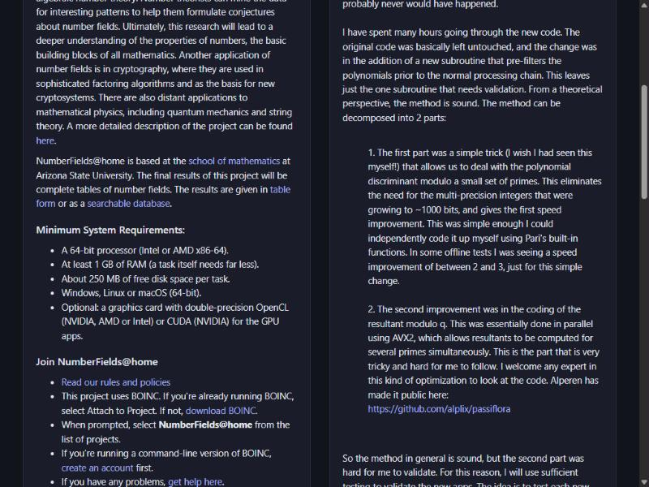

# Passiflora theme for NumberFields@home

A calm light and dark restyle of the NumberFields@home web site. The BOINC pages, menus, tables and forums stay exactly
as BOINC builds them; only colours, type and spacing change. It follows the light/dark setting of your system and works
on phones.

Coded By Alperen Yavuz · <https://github.com/alplix/passiflora>

## What changes

- colours, type, panels, tables, forms and buttons, in light and dark;
- the home page's system requirements, which described hardware from 2010 (128 MB of RAM, 32 MB of disk,
  "Intel/Amd processor", "Windows, Linux or Mac (x86)"): the same list in the same place, now with current values.

Nothing is added to the pages.

## For visitors (no change on the server)

**Userscript** (Tampermonkey, Violentmonkey, Greasemonkey): the style and the corrected requirements list. Install a
userscript manager, then open:

<https://raw.githubusercontent.com/alplix/passiflora/main/theme/numberfields-passiflora.user.js>

**Stylus** (style only). Install the Stylus browser extension, then open:

<https://raw.githubusercontent.com/alplix/passiflora/main/theme/numberfields-passiflora.user.css>

## For the project administrators

`white.css` is a drop-in replacement for the project's colour file (`html/user/white.css`, served as
`/NumberFields/white.css`). The site's pages already load it, so nothing else changes:

1. Keep a copy of the current `white.css`.
2. Copy `theme/white.css` from this folder over it.

To go back, restore the copy. The theme only uses the classes the BOINC web pages and Bootstrap 3 already produce.
The requirements list is page content: the five lines are in `enhance.js` if you want to put them into the home page.

## Files

| File | Purpose |
|---|---|
| `theme.css` | the stylesheet (source) |
| `enhance.js` | the corrected requirements list (source) |
| `build.py` | builds the three files below from the two sources |
| `numberfields-passiflora.user.js` | userscript |
| `numberfields-passiflora.user.css` | Stylus user style |
| `white.css` | drop-in for the web folder |

Licence: GPL-2.0-or-later.
