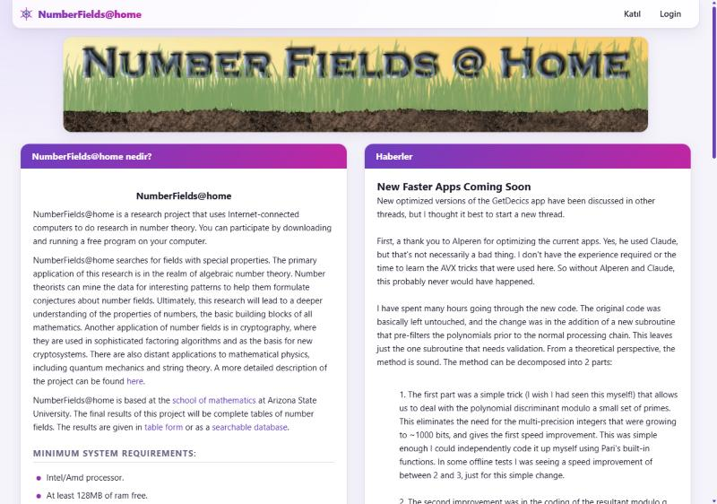
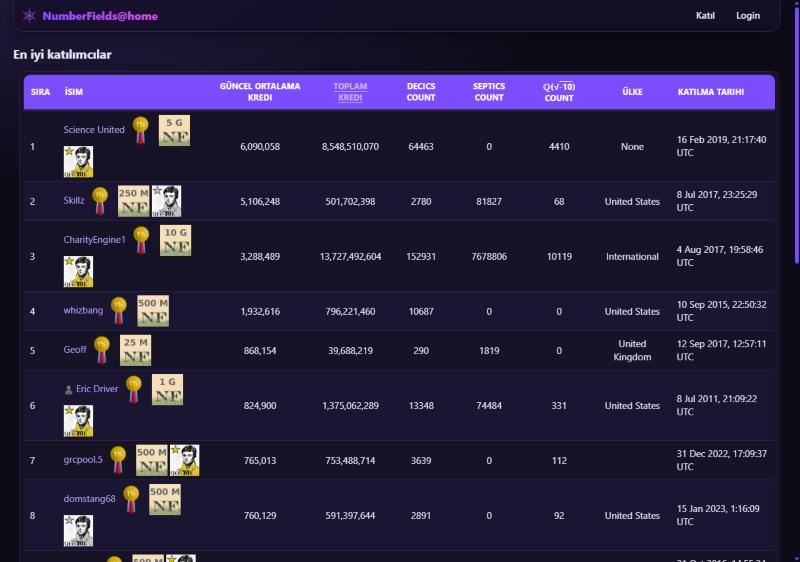
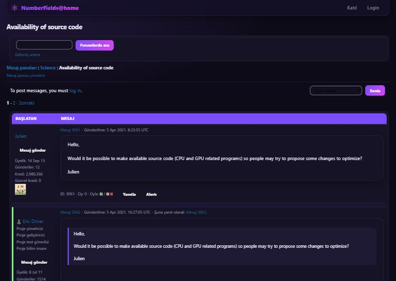

# Passiflora theme for NumberFields@home

A modern light and dark theme for the NumberFields@home web site, in the colours of the passion flower.
It restyles the whole site (home, tables, forums, forms, account pages) and works on phones.

Coded By Alperen Yavuz · <https://github.com/alplix/passiflora>

## For visitors (no change on the server)

**Userscript** (style + theme switch in the menu + a Passiflora download card on the home page).
Install a userscript manager (Tampermonkey, Violentmonkey, Greasemonkey), then open:

<https://raw.githubusercontent.com/alplix/passiflora/main/theme/numberfields-passiflora.user.js>

**Stylus** (style only). Install the Stylus browser extension, then open:

<https://raw.githubusercontent.com/alplix/passiflora/main/theme/numberfields-passiflora.user.css>

The theme follows the light/dark setting of your system. With the userscript, the menu entry at the top right switches
between *Auto*, *Light* and *Dark*; the Passiflora card on the home page can be hidden with *Hide*.

## For the project administrators

`white.css` is a drop-in replacement for the project's colour file (`html/user/white.css`, served as
`/NumberFields/white.css`). The site's pages already load it, so nothing else changes:

1. Keep a copy of the current `white.css`.
2. Copy `theme/white.css` from this folder over it.

To go back, restore the copy. The theme only uses the classes the BOINC web pages and Bootstrap 3 already produce.

## Files

| File | Purpose |
|---|---|
| `theme.css` | the stylesheet (source) |
| `enhance.js` | theme switch and the home page card (source) |
| `build.py` | builds the three files below from the two sources |
| `numberfields-passiflora.user.js` | userscript |
| `numberfields-passiflora.user.css` | Stylus user style |
| `white.css` | drop-in for the web folder |

Licence: GPL-2.0-or-later.
